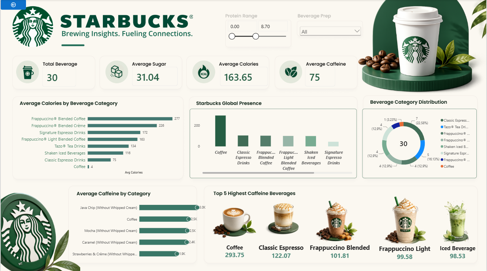

# Starbucks Beverage Analysis Dashboard

## Project Overview

This project presents an interactive Power BI dashboard for analyzing Starbucks beverages and their nutritional information.

## Dashboard Preview

## Tools Used

- Microsoft Power BI
- Power Query
- DAX 

## Key Insights

- Average caffeine content by beverage
- Average calories by beverage category
- Sugar and nutritional analysis
- Beverage preparation and category comparisons
- Interactive filters and slicers

## Skills Demonstrated

- Data analysis
- Data visualization
- Dashboard development
- Interactive reporting

## Project File

The Power BI report is available in this repository as a `.pbix` file.

## Author

Jitesh Yadav
